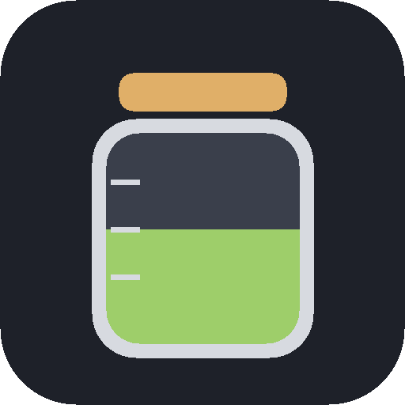
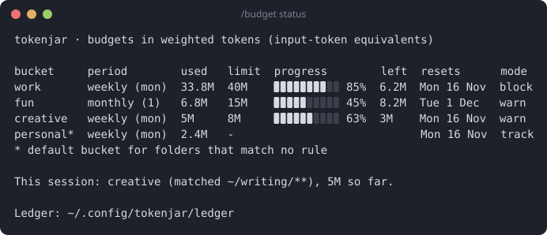
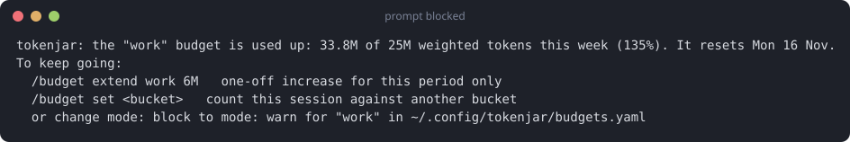

<p align="center"></p>

<h1 align="center">tokenjar</h1>

<p align="center">Token budgets per bucket for Claude Code: <b>work</b>, <b>fun</b>, <b>creative</b>, whatever you like.<br>
Track where your tokens go, see progress in the status line, get warned or stopped when a jar is empty.</p>

> [!IMPORTANT]
> **Privacy: everything stays on your machine.** tokenjar makes **no network calls** and has **no telemetry**.
> It reads Claude Code's local transcripts and stores **only token counts and metadata** (session id, timestamp,
> model name, folder, bucket). It never stores, copies or sends prompt or response content.
> The only files it writes are in its own config folder (and in your `ledger_dir`, if you turn on sync mode),
> plus `statusLine` in `~/.claude/settings.json` if you install the status line yourself.






*(Screenshots are rendered from the real CLI on synthetic demo data: `node tools/demo.js`.)*

---

## Install

```text
/plugin marketplace add OWNER/tokenjar
/plugin install tokenjar@tokenjar
```

Replace `OWNER` with the GitHub account that hosts this repository. Then, in Claude Code:

```text
/budget init                  # creates budgets.yaml from the example
/budget statusline install    # optional: adds the status line (keeps an existing one)
/budget                       # see where you stand
```

**Requirements:** Node.js 18 or newer on your `PATH` (hooks run `node`). No other dependencies.
macOS, Linux and Windows are supported.

The first `/budget` reads all your existing transcripts once. With a lot of history this can take
some seconds; after that only new data is read.

## How it works

1. **Ledger.** After each turn (Stop / SubagentStop / SessionEnd hooks) tokenjar reads the *new* part of
   the session's transcript in `~/.claude/projects/` and appends one small JSON line per API response to a local,
   append-only ledger. Re-reading a transcript never double counts: every response is keyed by its message
   and request id, and a local key index records what is already in the ledger.
2. **Buckets.** Each session is put in a bucket by its folder (glob rules in `budgets.yaml`), or by
   `/budget set` for the current session.
3. **Budgets.** Before each prompt (UserPromptSubmit hook) tokenjar checks the session's bucket. At the warn
   threshold you get a one-time warning. At 100% in `block` mode, the prompt is stopped with a message that
   explains how to continue.
4. **Status line.** `creative ▓▓▓░░ 63% · resets Mon`, coloured green / yellow / red.

### What gets counted

Claude Code transcripts record four kinds of tokens per response: input, output, cache writes and cache reads.
Cache reads are by far the largest number in long sessions, but they are also by far the cheapest. Counting
every token equally would make a long, well-cached session look ten times more expensive than it is.

So by default budgets use a **weighted** metric, an *API-equivalent cost in input-token units*:

| token type | default weight |
| --- | --- |
| input | 1 |
| output | 5 |
| cache write (5 min) | 1.25 |
| cache write (1 h) | 2 |
| cache read | 0.1 |

The weights are configurable, and you can switch to `metric: raw` (every token counts 1) or `metric: output`.

> [!NOTE]
> **Budgets are your own targets**, in absolute amounts of the metric ("work may use 20M per week"). The %
> tokenjar shows is *used ÷ your limit*, not your plan's usage. To relate the two, see
> [Budgets as a share of your plan](#budgets-as-a-share-of-your-plan).

### Budgets as a share of your plan

On Pro, Max and Ultra plans, Claude Code tells the **status line** how much of the plan's weekly (and
5-hour) limit is used. Hooks don't get this, so it needs the tokenjar status line installed. Each time the weekly %
moves, tokenjar notes how many tokens were used meanwhile and learns roughly **how many tokens equal 1% of
your weekly plan**. It needs at least 2 points of movement to give an estimate. Then:

* `/budget status` shows the plan's weekly %, the estimate, and each bucket's approximate share of the
  current plan week, e.g. `work ≈18%, personal ≈3%; Claude Code ≈21% of the 34% reported`.
* Limits can be written as a share of the plan:

  ```yaml
  work:
    limit: 30% of plan     # = 30 × (tokens per 1% of the weekly plan)
    period: weekly
  ```

  For daily or monthly buckets the share is scaled to the period length (a 30-day month = 30/7 plan weeks).
  Until the estimate exists, such a bucket is tracked with no limit (`calibrating`) and never blocks.
* `statusline: {show_plan: true}` adds ` · plan 34%` to the status line.

This is an **estimate**. The plan % also counts usage tokenjar can't see (claude.ai chat, cloud sessions,
other machines without tokenjar), Anthropic doesn't publish how plan usage is weighted, and plan snapshots
are kept per machine. The estimate gets better the more you use Claude Code compared with everything else.

## Configuration

`budgets.yaml` lives in your user config folder:

| OS | path |
| --- | --- |
| macOS / Linux | `~/.config/tokenjar/budgets.yaml` (or `$XDG_CONFIG_HOME/tokenjar`) |
| Windows | `%APPDATA%\tokenjar\budgets.yaml` |

(`TOKENJAR_HOME` overrides the folder.) `/budget init` writes this example:

```yaml
metric: weighted          # weighted | raw | output
default_bucket: personal  # sessions in folders that match no rule

buckets:
  work:
    paths: [~/work/**, ~/clients/**]
    period: weekly        # daily | weekly | monthly
    reset_day: mon        # weekly: mon..sun   monthly: 1..31
    limit: 20M            # k / M / B suffixes
    warn_at: 80%
    mode: block           # warn | block

  fun:
    paths: [~/fun/**]
    period: monthly
    reset_day: 1
    limit: 5M

  creative:
    paths: [~/writing/**]
    limit: 3M

  personal:               # no limit: tracked only
    period: monthly
```

* **Folder rules:** `~/work/**` (the folder and everything below), `~/work` (same), `~/code/*/fun` (one
  level), `**/scratch/**` (anywhere). The most specific match wins; ties go to the bucket listed first.
  Matching ignores case on Windows and macOS.
* **Periods** reset at local midnight. A monthly `reset_day: 31` falls on the last day in shorter months.
* **Mistakes** in the file never break a session. `/budget status` lists them; if the file doesn't parse at
  all, nothing is blocked until it does.
* Also supported: `weights`, `model_multipliers` (scale the weighted metric per model), `warn_at` and `mode`
  at the top level as defaults, `statusline.bar_width`. A `budgets.json` with the same structure works too.

### Which bucket does a session go to?

tokenjar never looks at what you talk about, only at **where** a session runs. In order:

1. **`/budget set <bucket>`** for that session, if you used it.
2. **Folder rules**: the session's start folder is matched against each bucket's `paths`. The most
   specific match wins.
3. **`default_bucket`**: everything else.

A bucket without `paths` (say, `creative` with only a limit) gets nothing from folder rules. Sessions only
land there through `/budget set`.

**Folder or `/budget set`?** If a kind of work has a home, give it a folder:

```yaml
  creative:
    paths: [~/writing/**, ~/projects/stories]
```

Every session started there counts as `creative` automatically, including new sessions after `/clear`. Use
`/budget set` for the exceptions: a one-off creative session started in your home folder, or a work
session in a folder that is normally personal.

**How long does `/budget set` last?** It is stored with the session id, in the ledger (so it syncs too):

| you do | the bucket you set |
| --- | --- |
| keep chatting, `/compact`, auto-compact | **kept** (same session) |
| `/clear`, or start a new session | **not kept**: the new session follows folder rules again. Run `/budget set` again if needed |
| `/budget set auto` | removed: back to folder rules |

Usage before a `/clear` stays in the bucket you set. `/budget set` also moves what the session already
used, so you can run it at any point in a session. Setting a bucket name that is not in `budgets.yaml` works,
but that bucket is tracked without a limit (tokenjar tells you so).

**After changing folder rules**, run `/budget rebucket` to preview which past sessions would move, and
`/budget rebucket --apply` to move them. Sessions you placed with `/budget set` stay where you put them.

**Common mistake:** every bucket must be indented under `buckets:`. A bucket name at the start of the
line is read as an unknown top-level setting; `/budget status` reports it as `unknown setting (ignored)`.

## Commands

| command | what it does |
| --- | --- |
| `/budget` or `/budget status` | all buckets: used, limit, progress, remaining, reset date, mode |
| `/budget set <bucket>` | count **this session** against another bucket (its usage so far moves too). `/budget set auto` undoes it |
| `/budget extend <bucket> <amount>` | one-off increase for the current period, e.g. `/budget extend work 5M` |
| `/budget usage` | today / this week / this month / all time per bucket |
| `/budget rebucket [--apply]` | after changing folder rules, re-file past sessions (explicit `set`s are kept) |
| `/budget init` | create `budgets.yaml` from the example |
| `/budget statusline install` / `uninstall` | add or remove the status line |

`/budget` commands are never blocked, so you can always extend or switch buckets.

You can also just ask: *"how much have I spent on work this week?"* or *"which project used the most tokens
this month?"*. The bundled `spend` skill gives Claude a summary of your local numbers to answer from.

## Status line

Plugins can't register a status line by themselves, so `/budget statusline install` adds it to
`~/.claude/settings.json` (a backup is saved next to it as `settings.json.tokenjar-backup`).

* If you already have a status line, it is **kept**: its output is shown first and the tokenjar segment is
  added after it. `uninstall` restores your original.
* The setting points to a small stable script in the tokenjar config folder that forwards to the installed
  plugin version, so plugin updates don't break it.
* Set `NO_COLOR=1` to turn colours off.

## Sync between machines (optional)

Point the ledger at a folder you already sync (Dropbox, iCloud Drive, Syncthing, OneDrive...):

```yaml
ledger_dir: ~/Dropbox/tokenjar
machine_name: laptop      # optional, defaults to the hostname
```

Each machine writes only its own `ledger-<machine>.jsonl`, and totals are the sum of all files, so the sync
tool never has to merge anything and no backend is involved. Your existing history is copied over the first
time. Overrides and extensions are ledger entries too, so they apply on every machine.

* Use the same bucket names everywhere. Folder rules are per machine (paths differ between machines anyway).
* Sync conflict copies (`ledger-x (conflicted copy).jsonl`, `*.sync-conflict-*`, renamed duplicates) are
  detected and ignored, and listed in `/budget status`.
* If two machines end up with the same name, tokenjar notices and tells you to set `machine_name`.
* With "online-only" / "optimise storage" settings, keep the folder available offline, or other
  machines' files may be missing locally.

## Where it works

| surface | tracking, warnings, blocking, `/budget` | status line |
| --- | --- | --- |
| Claude Code in a terminal | yes | yes |
| VS Code extension | yes (verified: shared `~/.claude`, transcripts and plugins) | the extension panel has its own status display; run `claude` in the integrated terminal to see the tokenjar line |
| JetBrains plugin | expected (it runs the CLI in the IDE terminal), not verified | expected |
| Desktop app, local sessions | expected (same `~/.claude`), not verified | not verified |
| Claude chat apps, cloud / web sessions | no: no local transcripts | no |

Usage from all local surfaces lands in the same `~/.claude/projects/`, so one ledger covers them all.

## Files

```text
<config folder>/
  budgets.yaml                 your config
  ledger/ledger-<machine>.jsonl   append-only usage ledger (or in ledger_dir)
  machine.json                 random id identifying this machine's ledger
  statusline.js                status line shim (only if installed)
  state/                       local caches, offsets, key index, tokenjar.log (safe to delete)
```

A ledger line looks like this. Counts and metadata only:

```json
{"t":"u","k":"msg_01…|req_01…","s":"<session id>","ts":"2026-11-14T10:00:00.000Z","b":"work","m":"<model>","cwd":"/home/me/work/api","in":3,"out":412,"cr":48211,"cw5":1310,"cw1":0}
```

Deleting `state/` is always safe: it is rebuilt from the ledger. Deleting the ledger rebuilds it from
whatever transcripts Claude Code still has.

## Reliability

* **Hooks never break your session.** Any internal error is logged to `state/tokenjar.log` and the prompt is
  allowed. Hooks also have a hard time limit.
* **Fast.** Hooks read only new transcript bytes (with a per-call cap) and skip all writes when nothing changed.
  They add roughly 30–60 ms on top of Node's own start-up time.
* **Format changes.** Claude Code's transcript format is not a public API. All parsing lives in one module
  (`plugins/tokenjar/lib/transcript.js`) that ignores unknown fields and logs, rather than crashes on, surprises.

## Development

```bash
npm test                 # node:test suite, no dependencies
node tools/demo.js       # regenerate the README screenshots from synthetic data
claude plugin validate ./plugins/tokenjar
```

Why not build on [ccusage](https://github.com/ryoppippi/ccusage)? It is a great reporting tool, but tokenjar
needs a hook-speed (well under a second), dependency-free, strictly offline parser with buckets and an
idempotent ledger. tokenjar does reuse ccusage's insight of deduplicating responses by message and request id.

## Licence

MIT. tokenjar is an independent project, not affiliated with or endorsed by Anthropic.
